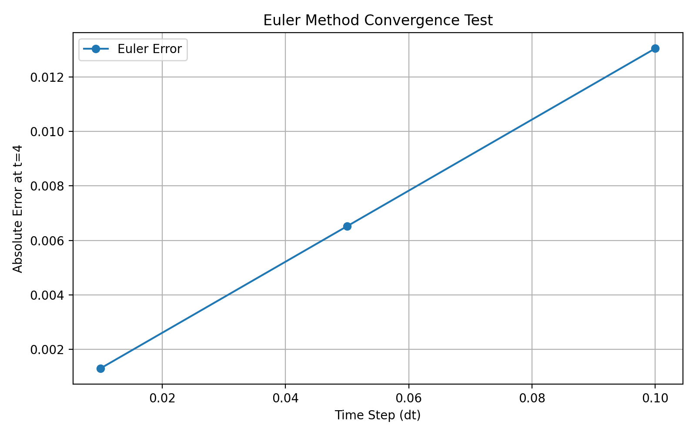
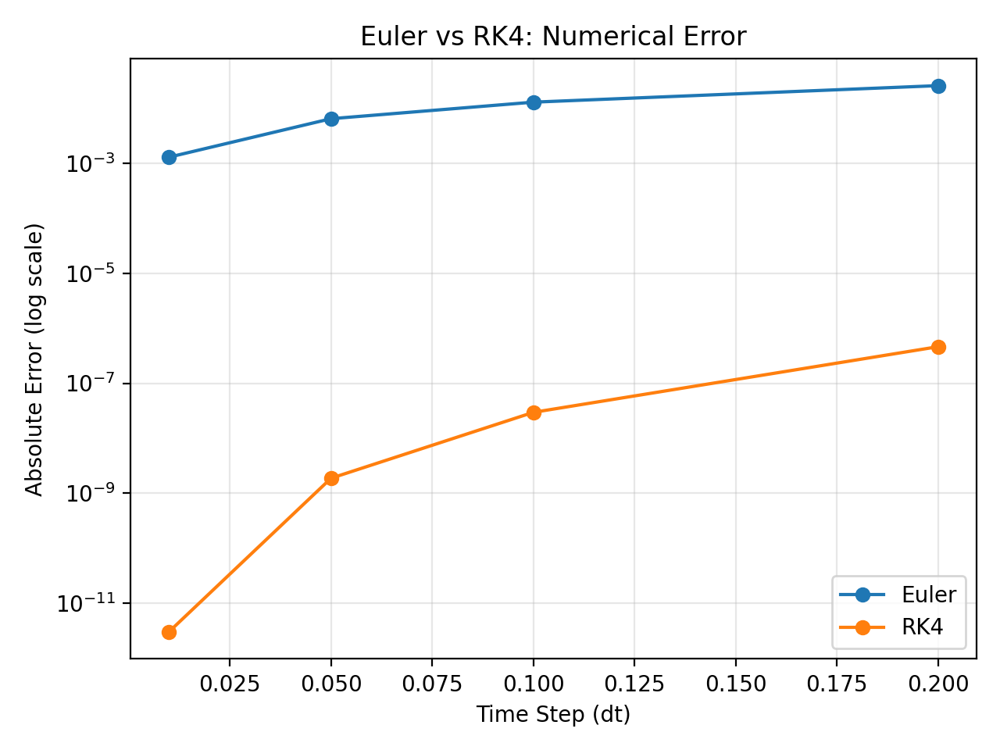

# Cosmic OS Verification

**아이디어에서 검증으로 — Python 기반 수치 시뮬레이션 및 알고리즘 비교 프로젝트**

## 프로젝트 소개

Cosmic OS는 정보, 엔트로피, 물리 시스템의 관계를 탐구하면서 시작한 개인 프로젝트입니다.

탐구 과정에서 수학적 모델을 제안하는 것과 실제로 검증하는 것은 다르다는 문제를 발견했습니다.

이를 계기로 Python을 활용해 미분방정식의 수치해를 계산하고, 해석해와 비교하는 실험을 진행했습니다. 나아가 서로 다른 수치 계산 알고리즘의 정확도와 계산 비용을 비교했습니다.

## Experiment 01. 수치 계산의 정확도 검증

미분방정식에 Euler 방법을 적용하고, 시간 간격(dt)에 따른 오차 변화를 측정했습니다.

| 시간 간격(dt) | 절대오차 (t=4) |
| --- | --- |
| 0.10 | 0.01304677 |
| 0.05 | 0.00652087 |
| 0.01 | 0.00130324 |

시간 간격을 줄일수록 오차가 감소했으며, Euler 방법의 예상되는 1차 수렴 특성과 일치하는 결과를 얻었습니다.



## Experiment 02. 정확도와 계산 비용 비교

Euler 방법과 4차 Runge-Kutta 방법(RK4)을 동일한 미분방정식에 적용했습니다.

**동일한 기울기 계산 횟수에서 어느 방법이 더 정확한가?** 라는 질문을 중심으로 비교했습니다.

| 방법 | 시간 간격(dt) | 기울기 계산 횟수 | 절대오차 (t=4) |
| --- | --- | --- | --- |
| Euler | 0.05 | 80회 | 0.0065208658 |
| RK4 | 0.20 | 80회 | 0.0000004623 |

동일한 80회의 기울기 계산에서 RK4는 Euler보다 약 **14,100배 작은 오차**를 기록했습니다.

이번 실험을 통해 계산 횟수뿐 아니라 알고리즘의 선택이 정확도에 큰 영향을 줄 수 있음을 확인했습니다.

※ 계산 비용은 실제 실행 시간이 아닌 기울기 평가 횟수를 기준으로 측정했습니다.



## 프로젝트 구성

| 파일 | 역할 |
| --- | --- |
| `simulator.py` | 미분방정식 시뮬레이션 |
| `convergence_test.py` | 시간 간격별 오차 분석 |
| `compare_methods.py` | Euler·RK4 정확도 및 계산 비용 비교 |
| `plot_results.py` | 실험 01 결과 시각화 |
| `plot_method_comparison.py` | 실험 02 결과 시각화 |
| `convergence_plot.png` | 실험 01 그래프 |
| `method_comparison_plot.png` | 실험 02 그래프 |
| `results/` | 실험 데이터 및 결과 기록 |

## 실행 방법

Python 3 환경에서 다음 명령어를 실행합니다.

```bash
python -m pip install matplotlib
python simulator.py
python convergence_test.py
python plot_results.py
python compare_methods.py
python plot_method_comparison.py
```

## 프로젝트를 통해 얻은 것

이 프로젝트에서 가장 중요하게 생각한 것은 **AI를 활용해 만든 결과를 검증 가능한 실험으로 발전시키는 과정**입니다.

- 추상적인 아이디어를 계산 가능한 문제로 구체화
- 해석해를 기준으로 수치 계산의 정확도 측정
- 서로 다른 알고리즘의 정확도와 계산 비용 비교
- 실험 결과를 코드, 데이터, 그래프와 문서로 기록

코드 구현과 실험 구성에는 AI의 도움을 활용했습니다.

실험 결과는 수치 계산 방법의 특성을 비교한 것이며, Cosmic OS의 물리학적 가설 자체를 입증하는 것은 아닙니다.

앞으로는 이러한 검증 과정을 확장하고, AI가 생성한 코드의 작동 원리를 이해하며 독립적으로 개선할 수 있는 역량을 발전시키고자 합니다.


