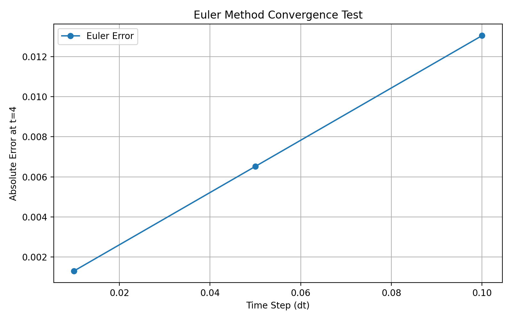

# 실험 01: Euler 방법의 수렴성 검증

## 실험 목적 (Objective)

Cosmic OS에서 사용한 단순화된 질서 매개변수 전이 방정식을 대상으로 Euler 방법의 수치 계산 정확도를 검증한다.

## 수학적 모델 (Mathematical Model)

단순화된 방정식은 다음과 같다.

`gamma * dpsi/dt = lambda * psi * (1 - psi^2)`

매개변수:
- gamma = 2.0
- lambda = 1.0
- 초기 조건: psi(0) = 0.1
- 시뮬레이션 구간: t = 0부터 10까지

위 매개변수에 대한 해석해는 다음과 같다.

`psi(t) = 1 / sqrt(1 + 99 * exp(-t))`

## 실험 방법 (Method)

Python으로 Euler 방법을 구현하고, 수치 계산 결과를 해석해와 비교했다.

시간 간격(dt)을 0.1, 0.05, 0.01로 변경하며 총 세 번의 시뮬레이션을 진행했다.

## 실험 결과 (Results)

t = 4에서 측정한 절대오차는 다음과 같다.

| 시간 간격(dt) | 수치해 | 해석해 | 절대오차 |
| --- | --- | --- | --- |
| 0.1 | 0.583159 | 0.596205 | 0.013047 |
| 0.05 | 0.589685 | 0.596205 | 0.006521 |
| 0.01 | 0.594902 | 0.596205 | 0.001303 |

## 주요 발견 (Findings)

시간 간격을 줄일수록 수치 계산의 오차가 감소했다.

시간 간격을 0.1에서 0.01로 줄였을 때, t = 4에서의 절대오차는 약 10분의 1로 감소했다.

이는 Euler 방법의 1차 수렴 특성과 일치하는 결과다.

## 실험의 한계 (Limitations)

이 실험은 단순화된 미분방정식에 대한 수치 계산의 특성을 확인한 것이며, Cosmic OS의 물리학적 타당성이나 우주론적 예측을 검증한 것은 아니다.

전체 소산 모델을 검증하고 예측 결과를 관측 데이터와 비교하려면 추가 연구가 필요하다.

### 실험 결과 시각화

### 실험 대상 선정 배경

Cosmic OS에서는 정보 처리와 소산 현상, 시스템의 상태 변화 사이의 관계를 탐구했습니다. 이 과정에서 질서 매개변수의 변화를 나타내는 단순화된 비선형 미분방정식을 다뤘습니다.

복잡한 모델 전체를 검증하기에 앞서 수치 계산 과정의 정확성을 확인하기 위해, 이 방정식을 첫 실험 대상으로 사용했습니다.

특히 해석해가 존재하므로 수치 계산 결과와 비교해 오차를 정량적으로 측정할 수 있다는 장점이 있습니다.

따라서 본 실험은 Cosmic OS의 물리학적 가설을 검증하기보다는, 이후 더 복잡한 모델을 다루기 위한 수치 계산 방법의 정확성을 확인하는 기초 실험입니다.
